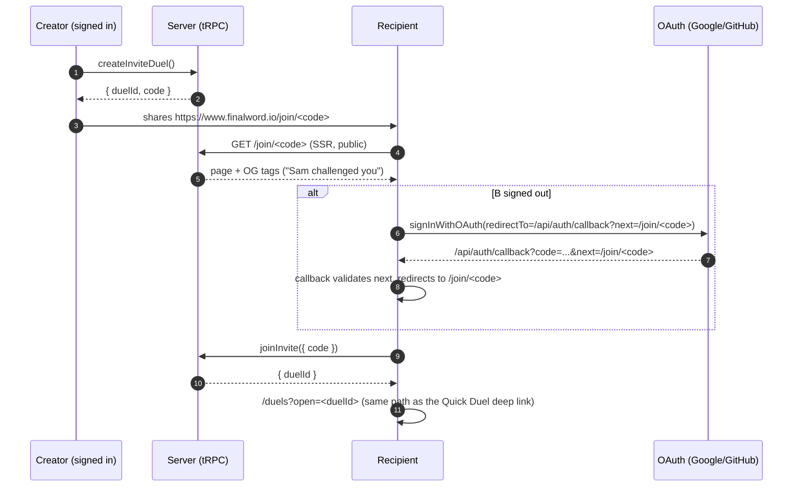

# Design Document — Duel Invite Links

Status: **Revised after review** (no code written yet)

## 1. Summary

Let a signed-in player create a duel and share a link (`/join/<code>`) with
anyone. The recipient opens the link, signs in (Google/GitHub) if needed, and is
dropped into the duel. This turns every duel into an acquisition loop: each
shared link is a pre-qualified visitor who already has a reason to sign up.

**Sign-in is required.** Anonymous play via link is explicitly out of scope.

Two pieces of work, shipped in this order:

1. **Guess privacy** (Section 6): opponents' guesses stop reaching the client
   until the viewer's own game has ended. This is a fix to **existing** duels
   and a prerequisite for links, because a stranger can now join after the
   creator has finished.
2. **Invite links** (Sections 4, 5, 7 to 10).

### Why now

PostHog shows most cold ad traffic never reaches a game (256 of 342 visitors
fired no custom event, and practice has no social hook). Duels need two people,
so a shared link is the most natural growth mechanic the product has.

## 2. Goals / Non-goals

**Goals**

- Create an invite duel from the Duels page and get a shareable link.
- A signed-out recipient signs in and **lands in the duel** (the link survives
  the OAuth round trip).
- Link previews look right in iMessage / Discord / Slack / WhatsApp.
- Joining reuses every existing duel rule: stats, results, head-to-head, 24-hour
  expiry, tier caps. **Invite duels follow the same logic as normal duels
  wherever possible**; differences are limited to what Section 7 lists.
- Joiner and creator become friends so rematches work (`sendDuel` and
  `rematchDuel` are friends-only).
- An opponent's guesses are never sent to a client whose own game has not ended.

**Non-goals (v1)**

- Anonymous / guest play from a link.
- Multi-player (3+) link duels. v1 is 1v1; the schema allows more later.
- App-sent email/SMS invites (the user shares the link themselves).
- Reusable/permanent links or links tied to a friend list.
- An OG image generator (one static image is enough for v1).

## 3. Decisions

| # | Decision | Choice |
|---|---|---|
| D1 | Friendship on join | Joining auto-creates an **accepted** friendship with the creator |
| D2 | Capacity | **1 opponent** (2 players). Stored as `max_participants` so it can grow; never above `1 + tierLimits.duelInvitees` |
| D3 | Joiner's active-duel cap | Counts like any duel (free 2 / premium 5), same error copy |
| D4 | Link lifetime | Same **24h** as the duel (`createdAt + DUEL_EXPIRY_MS`) |
| D5 | Auth requirement | Sign-in required; no anonymous link play |
| D6 | Guess visibility | A viewer sees an opponent's guesses **only once the viewer's own game has ended** (solved, ran out of guesses, forfeited, or timed out). Same condition that already reveals the secret word |
| D7 | Unjoined invite at expiry | Treated exactly like an invited player who **declined**: the normal completion path runs and the creator's result counts as it would in any 1v1 where the other player declined |
| D8 | Redirect after sign-in | `?next=` query on the OAuth `redirectTo`, validated against a strict allowlist; Supabase redirect URLs updated to permit it |
| D9 | Production origin | `https://www.finalword.io`. `finalword.app` is a leftover and is removed |

## 4. User flow



### Creator experience

1. Duels page, **"Invite with link"** (next to "New duel").
2. `createInviteDuel` creates the duel; the UI shows the link with **Copy** and,
   where supported, **Share** (`navigator.share`).
3. The creator can start playing immediately (async duel) or wait.
4. While nobody has joined, the duel row shows "Waiting for opponent" with
   **Copy link** and **Cancel invite**.

### Recipient experience (`/join/<code>`)

| Link state | Signed out | Signed in |
|---|---|---|
| Open | "Sam challenged you to a duel" + Google/GitHub buttons | "Sam challenged you" + **Join duel** |
| You're already in it | n/a | Redirect to the duel |
| Full | "This duel already has an opponent" + sign-in/practice links | Same message + link to `/duels` |
| Expired / completed / cancelled | "This invite has expired" | Same |
| Unknown code | 404-style page | Same |

The open state includes: "You'll also become friends with Sam so you can
rematch."

## 5. Data model

### 5.1 `duels` (invite columns)

Drizzle migration; both columns are nullable so existing rows are untouched.

```ts
// packages/db/src/schema.ts — duels
inviteCode: text("invite_code").unique(),          // null = not an invite duel
maxParticipants: integer("max_participants"),      // null = fixed participant list
```

- A duel is an **invite duel** iff `invite_code IS NOT NULL`.
- An invite duel is **open** while `participants.length < max_participants`, it
  is not completed, and it is not past its deadline.
- `invite_code`: 11 characters of base64url from `crypto.randomBytes(8)`
  (~64 bits), generated server-side with a retry on unique violation.
  Unguessable, so enumeration is impractical.
- The code is deliberately **not** the duel UUID, so it can be revoked (cancel)
  without touching identifiers used by realtime channels and RLS.
- No RLS change is needed for membership. `duels_select_participant` already
  matches `auth.uid()::text = any(participants)`, so a joiner gains read access
  when their id is appended. The public join page reads through the server's
  privileged connection, not RLS.

### 5.2 `duel_guesses` (guess privacy, see Section 6)

```ts
export const duelGuesses = pgTable("duel_guesses", {
  duelId: uuid("duel_id").notNull().references(() => duels.id, { onDelete: "cascade" }),
  userId: uuid("user_id").notNull().references(() => profiles.id, { onDelete: "cascade" }),
  guesses: text("guesses").array().notNull().default([]),
}, (t) => [primaryKey({ columns: [t.duelId, t.userId] })]);
```

## 6. Guess privacy (prerequisite, fixes existing duels)

### 6.1 The problem, confirmed in code

Guesses reach the client by two independent paths:

1. **tRPC**: `buildDuelResponse` returns `participant: participants`, which is
   **every** participant's full row including `guesses`. It is used by
   `startOrResumeDuel`, `handleDuelGuess` and `getDuelResult`.
2. **Realtime / PostgREST**: `useDuelRealtime` selects `guesses` for every
   participant, and `duel_participants_select_participant` lets any participant
   read every other participant's row.

An opponent's final winning guess **is** the secret word. Today a late-starting
invitee can read it; with links a stranger can.

### 6.2 Why a column-level tweak is not enough

Row Level Security filters rows, not columns, and Realtime delivers the full
row. Removing `guesses` from the client's select list is a convenience, not a
security boundary, because a client can issue its own query. The only reliable
boundary is to keep guesses **out of any table the client can read**.

### 6.3 Design

Mirror the existing `duel_secrets` pattern:

- Move guesses to `duel_guesses` (Section 5.2).
- Enable RLS on it with **no client SELECT policy** and **do not add it to the
  `supabase_realtime` publication**. Clients cannot read it at all.
- `duel_participants` keeps everything non-sensitive: `start_time`, `end_time`,
  `total_guesses`, `success`, `accepted`, `forfeited`, etc. Opponent progress
  (count of guesses, finished or not) still streams in realtime from
  `total_guesses` and `end_time`.
- The server reads guesses from `duel_guesses` and decides what to return.

**Redaction rule** (single function, used by every tRPC response that returns
participants):

```
include another participant's guesses  <=>  the viewer's own row has end_time != null
```

This is the same condition `buildDuelResponse` already uses to reveal
`secretWord`. It covers solved, out of guesses, forfeited and timed out (expiry
sets `end_time`). A viewer who **declined** has no `end_time`, so they get no
guesses (they can never play the duel, so they have no use for them).

The viewer's **own** guesses are always returned.

### 6.4 Code that changes

| Location | Change |
|---|---|
| `schema.ts`, new Drizzle migration | `duel_guesses` table |
| `supabase/migrations/…` | Enable RLS on `duel_guesses`, no SELECT policy, assert it is not in `supabase_realtime` |
| `handleDuelGuess` | Append to `duel_guesses.guesses` and update `duel_participants.total_guesses` in the **same transaction** |
| `buildDuelResponse` | Take a guesses map; apply the redaction rule; derive `matchResults` from the viewer's guesses |
| `getDuelResult`, `startOrResumeDuel` | Load guesses from `duel_guesses` and pass to `buildDuelResponse` |
| `planExpiredDuel` / `expireStaleDuel` | Use `totalGuesses === 0` instead of `guesses.length` |
| `useDuelRealtime` | Drop `guesses` from the select list and from `DuelParticipant` conversion |
| `duels.tsx` (live merge, opponent list), `duel-ribbon.tsx` | Use `totalGuesses`; take opponent guesses only from the tRPC result |
| `duel-result.tsx` | Opponent guess grids come from the redacted tRPC data (only present once the viewer finished) |

After the viewer finishes, an opponent still playing will not stream new guess
words live. The result view refreshes on the existing `opponentFinished` event
and on reopen; live **counts** continue to stream.

### 6.5 Migration plan (expand, then contract)

In-flight duels and installed PWAs running an older client make a one-step
change unsafe.

1. **Expand**: create `duel_guesses`, backfill from `duel_participants.guesses`.
2. **Cutover deploy**: server and client read/write `duel_guesses` only.
3. **Contract A** (after the deploy is live): set `duel_participants.guesses` to
   `'{}'` so historical guesses stop being readable. Old clients that still
   select the column keep working and just see empty arrays (their own board
   comes from tRPC).
4. **Contract B** (later, once stale clients are gone): drop the column.

Until step 3 runs, old data remains readable, so run it promptly after deploy.

## 7. Invite duel behaviour: where it differs from a normal duel

The aim is parity. Normal duels already handle "an invitee who hasn't responded":
that player has no `duel_participants` row, so `haveAllDuelParticipantsFinished`
is false and the duel waits. An **open slot** on an invite duel plays the same
role, but the slot has no user id yet, so the existing check cannot see it.

### 7.1 An open invite is "not finished"

Add one pure helper next to the other duel utilities:

```ts
isInviteOpen(duel: { inviteCode, maxParticipants, participants, completed, createdAt }, now): boolean
```

The three completion sites (`handleDuelGuess`, `forfeitDuel`, `declineDuel`)
treat an open invite as **not finished**. Without this, the creator finishing
alone would complete the duel before anyone joined. The creator can finish their
own game and wait, exactly as they would wait on a pending friend.

### 7.2 Expiry of an unjoined invite = declined (D7)

No special case. When the 24h deadline passes with the slot still open, the open
slot is simply treated as a **declined** invitee and the **normal** completion
path runs (`determineDuelWinner` + `persistDuelCompletion`):

- Creator solved it: they win, as in any 1v1 whose opponent declined.
- Creator did not finish: the existing rules for an unfinished creator apply
  (`planExpiredDuel`), giving a draw or timed-out result as they do today.
- Nobody played at all: ends with no winner, same as a normal duel.

`expireStaleDuel` needs no invite-specific branch beyond considering the duel
completable once expired.

### 7.3 Forfeit and cancel

`forfeitDuel` on an open invite behaves like forfeiting a normal duel whose
invitee hasn't answered (it does not complete early, per 7.1). Because that
leaves the creator's slot occupied until expiry, the UI offers **Cancel invite**
instead (Section 8.4) while the duel is open and solo.

## 8. API (tRPC, `duels` router)

### 8.1 `createInviteDuel` (protected mutation)

- Same tier and active-duel-cap checks as `sendDuel`. Extract the shared check
  into a helper so the two cannot drift.
- `max_participants = 2`.
- One transaction: insert `duels` (participants `[creatorId]`, `invite_code`,
  `max_participants`), insert `duel_secrets`, insert the creator's
  `duel_participants` row.
- Returns `{ duelId, code }`.

### 8.2 `getInvite` (public query) and SSR helper

Used by `/join/[code]` `getServerSideProps` (direct DB read). Returns a
**minimal** shape:

```ts
{ status: "open" | "full" | "expired" | "completed" | "not_found",
  inviterName: string | null }
```

Never returns ids, emails, the word, or participants.

### 8.3 `joinInvite({ code })` (protected mutation)

One transaction with `SELECT ... FOR UPDATE` on the duel row:

1. Not found / not an invite duel: `NOT_FOUND`.
2. Caller already in `participants`: return `{ duelId }` (idempotent; covers
   double-click, refresh, and the creator opening their own link).
3. `completed`: `BAD_REQUEST` ("This duel has already finished").
4. Past deadline: finalize via `expireStaleDuel`, then `BAD_REQUEST` ("This
   invite has expired").
5. `participants.length >= max_participants`: `BAD_REQUEST`.
6. Joiner's active-duel cap (D3), same message as `sendDuel`.
7. `participants = array_append(participants, callerId)`.
8. Friendship (D1), same transaction: look for a row in **either** direction;
   none: insert `(requester = creator, addressee = caller, accepted)`; `pending`:
   update to `accepted`; `accepted`: no-op.
9. No `duel_participants` row is created here. The joiner gets one through the
   existing `startOrResumeDuel` path (which stamps `startTime`), keeping a single
   definition of "accepted".

Returns `{ duelId }`.

### 8.4 `cancelInvite({ duelId })` (protected mutation)

Creator only, only while `participants.length === 1` and not completed. Deletes
the duel (`duel_secrets`, `duel_participants`, `duel_guesses` cascade). The code
then resolves to `not_found`. Exists because an unjoined invite otherwise holds
one of a free user's **2** active slots for up to 24h.

## 9. Auth redirect (D8)

Today `redirectTo` is `/api/auth/callback` and `pages/api/auth/callback.ts`
always redirects to `/`; a signed-out visit to `/` bounces to `/sign-in`, so any
destination is lost.

**Flow**

- The join page's sign-in buttons call `signInWithOAuth` with
  `redirectTo = ${origin}/api/auth/callback?next=${encodeURIComponent("/join/<code>")}`.
- `callback.ts` reads `next` after `exchangeCodeForSession` succeeds, validates
  it, and redirects there; otherwise `/`.
- The existing `/sign-in` page keeps its current `redirectTo` (no `next`), so
  normal sign-in is unchanged.

**Validation (prevents open redirects):** accept only a path matching
`^/join/[A-Za-z0-9_-]{8,32}$`. Anything else, including absolute URLs and
`//host`, is ignored. Extend the allowlist explicitly if other post-login
destinations are ever wanted.

**Supabase configuration (your side):** in Authentication > URL Configuration,
make sure **Redirect URLs** permit the callback with a query string. Use a
wildcard entry for the production origin and for local development, for example:

- `https://www.finalword.io/**`
- `http://localhost:3000/**`

If the apex domain (`finalword.io`) is also served rather than redirecting to
`www`, add it as well. Confirm the current entries first; an existing broader
wildcard may already cover this. Test with a real sign-in from `/join/<code>`
after changing it.

## 10. Frontend

| Piece | Notes |
|---|---|
| `pages/join/[code].tsx` | `getServerSideProps` reads status and inviter name; OG/Twitter tags; `noindex` meta. Not added to `robots.txt`, so link unfurlers can still reach it |
| `components/duels/invite-duel-button.tsx` | "Invite with link", then copy / share |
| Duel ribbon | "Waiting for opponent" state, **Copy link**, **Cancel invite** (replaces Forfeit while open and solo) |
| `pages/duels.tsx` | `?open=<duelId>` deep link modelled on the existing `?quick=1` handler: run once, strip the param, call the existing start handler |
| `pages/api/auth/callback.ts` | Read and validate `next` (Section 9) |

**Origin and domain (D9)**

- Share links are built from `window.location.origin`.
- Replace `finalword.app` with `https://www.finalword.io` in
  `src/utils/site.ts` (`SITE_URL`), `public/sitemap.xml` and `public/robots.txt`.
  This also corrects canonical and OG URLs. PostHog pageview URLs show `www`, so
  `www` is assumed canonical; confirm the apex redirects to it.

**OG image:** needs a 1200x630 static asset (none exists in `public/` beyond
favicons). Until it exists, previews are text-only.

## 11. Analytics

Four events, added to the closed `AnalyticsEvent` union, each answering a funnel
question:

| Event | Properties | Answers |
|---|---|---|
| `duel_invite_created` | `{ shared_via }` set on first copy/share | Do creators actually share? |
| `duel_invite_viewed` | `{ status, signed_in }` | Click-through, and how many hit a dead link |
| `duel_invite_signin_clicked` | `{ provider }` | Drop-off at sign-in |
| `duel_invite_joined` | `{ new_user: boolean }` | Conversion, and signups produced by the loop |

`new_user` = account created within a few minutes of joining, so "signups from
invite links" is one query.

## 12. Security and abuse

| Risk | Handling |
|---|---|
| Opponent guesses expose the word | Section 6: guesses live in a client-unreadable table and are returned only after the viewer's game ends |
| Code guessing | ~64-bit random code; `getInvite` leaks only status and inviter display name |
| Open redirect | Strict path allowlist on `next` (Section 9) |
| Race on the last slot | `FOR UPDATE` plus a capacity re-check in one transaction |
| Unwanted friendships | The joiner sees the friendship copy before joining; the creator chose to share. Removable on the Friends page |
| Public endpoint abuse | The repo has no visible rate limiting; see Q2 |
| Guest accounts | `protectedProcedure` allows anonymous users. If guest sign-in is still reachable, reject `is_anonymous` in `createInviteDuel` and `joinInvite` (matches checkout/portal). See Q3 |
| Duel word secrecy | The word stays in `duel_secrets`; unchanged |

## 13. Edge cases

- Creator opens their own link: idempotent redirect to the duel.
- Joiner already at their active-duel cap: error with a link to `/duels`; the
  invite stays open for someone else.
- Joiner already friends or has a pending request with the creator: handled by
  8.3 step 8.
- Two people click the last slot at once: one succeeds, the other sees "already
  has an opponent".
- Creator cancels after sharing: the code resolves to `not_found`.
- Link opened after expiry: "expired" page; the next `allDuels` load finalizes
  the duel (existing lazy expiry).
- Creator's account is removed: the duel and link disappear via existing
  cascades.
- Creator's open client must notice the joiner. A `duels` UPDATE (participants
  changed) must trigger a list refetch. Verify `useDuelRealtime` handles `duels`
  updates; if not, add a refetch on that event.

## 14. Testing

- **Guess privacy**
  - `buildDuelResponse` redaction: viewer unfinished sees only own guesses;
    viewer solved / out of guesses / forfeited / timed out sees all; viewer
    declined sees only own (none).
  - SQL check as an authenticated non-owner user: `select` on `duel_guesses`
    returns nothing; `duel_guesses` is absent from the `supabase_realtime`
    publication.
  - Manual: two accounts, confirm the second player's browser network and
    realtime frames never contain the first player's guess words before they
    finish.
  - Backfill: row counts and a spot check of guess arrays match.
- **Pure unit tests:** `isInviteOpen`; the `next` validator (valid code, other
  paths, absolute URLs, `//evil.com`, encoded variants, empty).
- **Router tests:** `createInviteDuel` caps; `joinInvite` happy path,
  idempotent re-join, full, expired, completed, over cap, friendship created /
  upgraded from pending / already accepted, anonymous rejected, concurrent join
  on the last slot; `cancelInvite` only while solo.
- **Regression:** a solo-invite creator finishing does **not** complete the duel
  (7.1); an expired unjoined invite completes through the normal declined path
  (7.2); non-invite duels behave exactly as before.
- **Manual:** signed-out, Google, lands in the duel on desktop and mobile
  Safari; link unfurl in iMessage, Discord and Slack.

## 15. Rollout

1. **Guess privacy** (Section 6) as its own release: migration (expand), server
   and client cutover, then contract A. It stands alone and fixes today's
   duels.
2. Domain cleanup (`site.ts`, sitemap, robots) and the Supabase redirect URLs.
3. Invite columns migration, `isInviteOpen`, and the changes to the three
   completion sites. Ships dark: nothing creates invite duels yet. Tests first.
4. `createInviteDuel`, `getInvite`, `joinInvite`, `cancelInvite`.
5. `/join/[code]`, `next` handling in the callback, `?open=` deep link.
6. Duels UI (button, waiting state, cancel) and analytics.
7. OG image.
8. Contract B (drop the old `guesses` column) after stale clients are gone.

Needs **database migrations and a client deploy**. The game server
(`apps/server`) is not involved; duels run entirely in the Next.js app.

Rollback: the invite columns are nullable and unused by other code, so reverting
app code is safe without reverting the migration. For guess privacy, rolling
back the app before contract A is safe because the old column still holds the
data; after contract A it would need a restore from `duel_guesses`.

## 16. Open questions

- **Q1.** Confirm `www.finalword.io` is canonical and that the apex redirects to
  it (this affects the Supabase redirect entries).
- **Q2.** Rate limiting for the public invite page: add now, or defer?
- **Q3.** Is guest (anonymous) sign-in still reachable in production? If so,
  reject guests on create and join.
- **Q4.** After joining, land in the board immediately (auto-open via `?open=`)
  or in the list with a Start button? The design assumes auto-open, since each
  player has their own timer.
- **Q5.** Are there installed-PWA clients old enough that contract B should wait
  longer than a normal release cycle?

## Resolved from review

- Guess visibility: hidden from opponents until the viewer's game has ended
  (D6, Section 6).
- Unjoined invite at expiry: same as a declined invitee, normal completion path
  (D7, Section 7.2).
- Invite duels follow normal duel logic, with differences limited to Section 7.
- `finalword.app` removed in favour of `https://www.finalword.io` (D9).
- Supabase redirect URLs will be updated by the project owner (Section 9).
